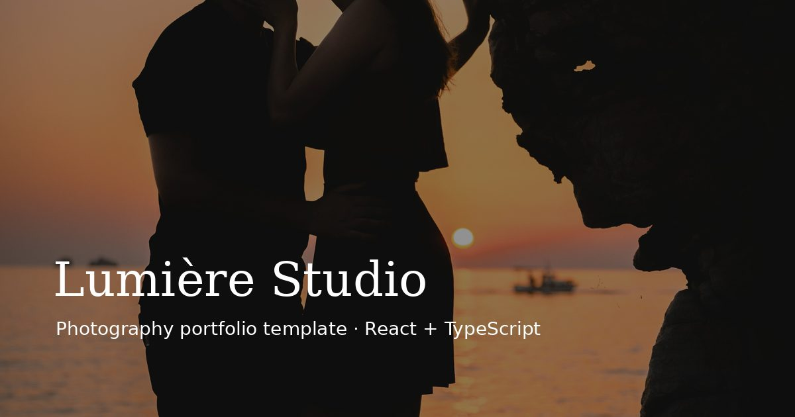

# Lumière Studio – Photography Portfolio Template

[](https://github.com/AlexRajdhami/photography-portfolio/actions/workflows/deploy.yml)



A responsive, single-page website template for a couple, wedding and portrait photographer. It's built with **React, TypeScript, Tailwind CSS and Framer Motion**.

**Live demo:** [alexrajdhami.github.io/photography-portfolio](https://alexrajdhami.github.io/photography-portfolio/)

> Design, development and photography by **Alex Rajdhami**. "Lumière Studio" is a demo brand, so the site can be reused as a template for a client.

## Features

- **Cinematic hero:** full-screen photo with a slow zoom
- **Filterable portfolio:**
  - masonry grid with Couples, Weddings and Portraits filters and animated transitions
- **Accessible lightbox:**
  - next and previous buttons, arrow keys, and Esc to close
  - focus is returned to the photo you opened, and the page can't scroll behind it
- **Fast images:**
  - camera originals (≈29 MB) converted to WebP at 640, 1280 and 2000 px (≈3 MB in total)
  - `srcset`/`sizes` and lazy loading, so each visitor downloads only the size their screen needs
- **Packages in £**, with a "Choose" button that fills in the booking form
- **Booking form:**
  - validates name, email, package, a future date and a message
  - accessible error messages
  - works as a demo by default; set `VITE_FORMSPREE_ID` to receive real enquiries by email through [Formspree](https://formspree.io)
- **Content and navigation:**
  - About, Process and FAQ sections
  - a mobile menu, a skip link and visible focus styles
  - respects the "reduce motion" setting
- **Tested:**
  - Vitest and Testing Library cover the form validation, gallery filters and lightbox keyboard controls
  - GitHub Actions tests, builds and deploys to GitHub Pages

## Tech stack

React 18 · TypeScript · Vite 5 · Tailwind CSS 3 · Framer Motion · Lucide icons · Vitest · GitHub Actions / Pages

## Run locally

```bash
npm install
npm run dev      # http://localhost:5173/photography-portfolio/
npm test         # unit and component tests
npm run build    # production build in dist/
```

## Reuse it for a client

All content lives in [`src/data.ts`](src/data.ts):
- studio name, packages, process steps and FAQs
- the photo list

To add photos:
1. Export each one as `name-640.webp`, `name-1280.webp` and `name-2000.webp` into `public/images/`.
2. Add an entry to `PHOTOS`.

## Licence

The code is under the MIT licence. **All photographs © Alex Rajdhami – not licensed for reuse.**
